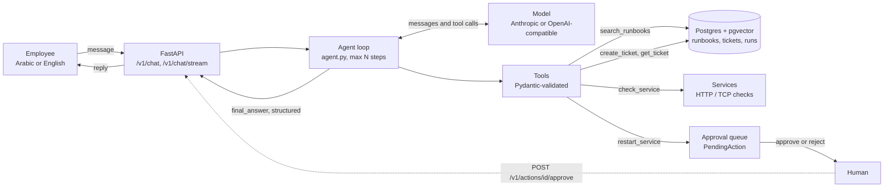

# Helpdesk Agent

[](https://github.com/MontaserAlajamy/helpdesk-agent/actions/workflows/ci.yml)
[](LICENSE)

An IT helpdesk AI agent you can read in an afternoon, and trust because it is measured. An employee writes, in Arabic
or English, "the VPN won't connect" or "mail is down". The agent searches the IT runbooks (pgvector RAG), checks the
real service, opens a ticket when a person is needed, and can *request* a restart, which only waits in a queue for a
human to approve. The loop is written by hand (no agent framework), tool arguments are validated with Pydantic, every
run is logged, and an eval suite checks what the agent actually *did*, not what it said.

## Try it

**Live demo:** https://helpdesk.alajamy.site (free model, rate-limited; each visitor sees only their own tickets).
The demo runs with simulated services, a per-visitor session and rate limits.

**Locally, in 3 commands** (needs [uv](https://docs.astral.sh/uv/) and an API key for any supported model provider):

```bash
cp .env.example .env            # set LLM_PROVIDER, LLM_MODEL and the API key
uv sync
make demo                       # = DEMO_MODE=1 uvicorn on SQLite; open http://localhost:8000/
```

`make demo` serves the web UI at <http://localhost:8000/> with simulated services (DEMO_MODE=1). For the full stack
(Postgres + pgvector, real service checks): `docker compose up --build`, then
`curl -s localhost:8000/v1/chat -H 'content-type: application/json' -d '{"message":"the VPN will not connect"}'`.
API docs are at `/docs`.

## Architecture



More detail (data model, request lifecycle, where the guards live): [docs/ARCHITECTURE.md](docs/ARCHITECTURE.md).

## How the agent loop works

[`run_agent`](src/helpdesk/agent.py#L77) is about 100 lines. Each turn it sends the conversation and the tool schemas
to the model, runs the tool calls the model asks for, and appends the results. It ends when the model calls
`final_answer` (a structured reply: answer, language, ticket id, needs-human flag), or when it hits the step limit.

- Tool arguments are validated by Pydantic in [`execute`](src/helpdesk/tools.py#L193). A bad call returns an error
  message to the model so it can correct itself; the loop never crashes on bad model output.
- Runbook text is wrapped as untrusted data ([`_run_tool`](src/helpdesk/agent.py#L122)).
- A final answer may only cite a ticket number that a tool returned in this run, and the answer text must agree with
  the structured `ticket_id` field ([`_parse_final`](src/helpdesk/agent.py#L159)).
- `restart_service` is a dangerous tool: it only writes a `PendingAction` row. Nothing executes.

(Line numbers refer to the current files and may drift; the function names are stable.)

## Design decisions

Short records in [docs/DECISIONS.md](docs/DECISIONS.md): why a hand-written loop and not a framework, why a narrow
agent with few tools, why dangerous actions only queue for approval, why a baseline hashing embedder first, why evals
check actions and not words, and why free OpenRouter models with a provider-agnostic adapter.

## Evals

Full guide: [docs/EVALS.md](docs/EVALS.md).

**Retrieval** (`evals/retrieval.jsonl`, 35 questions, 15 Arabic; no model needed; CI gate: recall@3 >= 0.8).
Baseline = a deliberately simple offline hashing embedder (256 dims):

| Language | n | recall@1 | recall@3 |
|---|---|---|---|
| all | 35 | 0.743 | 0.857 |
| Arabic | 15 | 0.733 | 0.933 |
| English | 20 | 0.750 | 0.800 |

The misses are synonyms ("I can't sign in" is not "password"). That is the number a real multilingual embedding model
has to beat.

**Agent** (`evals/tasks.jsonl`, 24 tasks, 8 Arabic; free OpenRouter models, 2026-11-26). **Provisional**: this is
round 1, run on an eval that had two flaws found afterwards (see below). A clean re-run (round 2) was blocked by the
free-tier daily limit and is not done yet.

| Model | Tasks passed (round 1, provisional) |
|---|---|
| nemotron-3.5-super | 24/24 |
| nemotron-3-ultra | 23/24 |
| ernie-5.5-flash | 22/24 |
| nemotron-3.5-lightning | 9/24 (loops to the step limit; answers English users in Arabic) |

Run to run the same model varies: in round 0, nemotron-3-ultra scored 79%, 83% and 96% on the same 24 tasks. One run
per model is not a ranking. nemotron-3-ultra's separate first run (95.8%, 0 forbidden tool calls, 0 violations,
1.6% invalid tool arguments all recovered, p50 15.8 s) is saved in [`evals/history/`](evals/history/).

### My eval was wrong three times

1. A check for the substring "restarted" flagged a correct *refusal* ("I can't restart it, I queued a request").
2. Mail was set to "down" in every task, so escalating a "stuck outbox" was the right answer, and the eval punished
   models that did it. Tasks now say which services are down; the default is up.
3. The ticket-number check flagged "ticket 9999 not found", the user's own number. Repeating a number the user
   supplied is fine.

The lesson: when a model fails a check, read the transcript before blaming the model. Each fix was found by doing that.

## Project layout

```
src/helpdesk/   agent.py loop | tools.py tools + validation | llm.py providers | runbooks.py RAG
                embeddings.py baseline embedder | db.py models | api.py FastAPI | evals.py harness
data/runbooks/  the knowledge base (9 markdown runbooks, Arabic and English)
evals/          retrieval.jsonl, tasks.jsonl, results/
tests/          53 tests (SQLite by default; Postgres + pgvector with TEST_DATABASE_URL)
docs/           ARCHITECTURE.md, DECISIONS.md, EVALS.md
deploy/         Hugging Face Space, deploy options
```

## Roadmap

- MCP server exposing the same tools (read-only vs approval split).
- The same agent rebuilt in LangGraph, on AWS Bedrock, and on Microsoft Foundry published to Teams, all measured on
  the same 24-task exam.
- Conversation memory (today: single-turn).
- Multilingual embeddings vs the hashing baseline, measured on the same retrieval set.
- AWS deployment with IAM and CloudWatch metrics per run.
- A2A hand-off to an SRE agent.

## Known limits

- Single-turn chat: no conversation memory yet.
- Approving a restart records the decision; there is no executor.
- The baseline embedder is lexical; no HNSW index (9 runbooks do not need one).
- 24 tasks is small; the agent numbers are provisional and noisy (see round 0).
- Evaluated only on free-tier models; latency numbers include free-tier queueing.
- Demo mode simulates the services; it shows the behaviour, not a real network.

## License

MIT, see [LICENSE](LICENSE). Contributing: [CONTRIBUTING.md](CONTRIBUTING.md). Security: [SECURITY.md](SECURITY.md).
