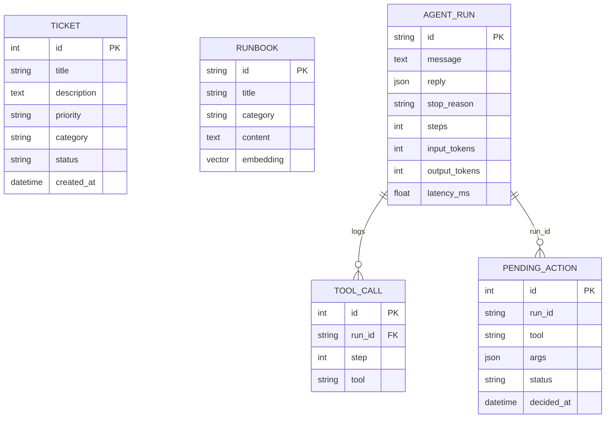
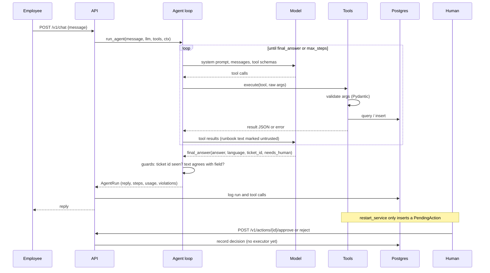

# Architecture

## Components

| Component | File | Job |
|---|---|---|
| API | `src/helpdesk/api.py` | FastAPI app: chat, tickets, approval queue, health. Builds the agent per request. |
| Agent loop | `src/helpdesk/agent.py` | Model <-> tools loop, step limit, guards, structured final answer. |
| Tools | `src/helpdesk/tools.py` | Pydantic argument models, risk level, implementations, `execute` wrapper. |
| LLM adapter | `src/helpdesk/llm.py` | One small interface; Anthropic and OpenAI-compatible providers. |
| Runbooks / RAG | `src/helpdesk/runbooks.py`, `embeddings.py` | Load markdown, embed, search (pgvector on Postgres, in-Python cosine on SQLite). |
| Data | `src/helpdesk/db.py` | Async SQLAlchemy 2 models. |
| Settings | `src/helpdesk/config.py` | Environment settings validated by Pydantic. |
| Evals | `src/helpdesk/evals.py` | Retrieval and agent evals, real local services, comparison table. |

The web UI, the streaming endpoint and demo mode are layered on the API; this document describes the core.

## Data model

`PENDING_ACTION.run_id` is a plain column (not a foreign key) pointing at the run that queued it. Priority is one of
low / medium / high / critical; category one of network, email, hardware, software, access, voip, server, other.

## Request lifecycle

## How tools are validated

Every tool is a `Tool` record: name, description, a Pydantic `args_model`, a risk level (`read`, `write`,
`dangerous`) and an async function. The JSON schema sent to the model comes from the Pydantic model, so the schema
and the validation cannot disagree. [`execute`](../src/helpdesk/tools.py#L193) validates the raw arguments the model
produced, runs the function, and never raises: a `ValidationError` or a `ToolError` becomes a JSON error message
returned to the model, which can retry. Enumerated fields (priority, category) are `Literal` types; `check_service`
and `restart_service` accept only names in the configured service allowlist.

## Where the guards live

| Guard | Where | What it stops |
|---|---|---|
| Step limit | `run_agent` (`max_steps`, default 6) | Endless loops (one evaluated model hit this regularly). |
| Argument validation | `tools.execute` | Malformed or out-of-range tool arguments. |
| Service allowlist | `check_service`, `restart_service` | Probing or restarting anything not configured. |
| Dangerous tools only queue | `restart_service` | The agent executing a restart. Needs a human. |
| Untrusted data marker | `_run_tool` | Prompt injection inside runbook text (also told in the system prompt). |
| Ticket citation check | `_parse_final` | Inventing a ticket number; recorded as a `violation`, field cleared, `needs_human` set. |
| Text/field agreement | `_parse_final` | Answer text citing a real ticket while `ticket_id` is empty: filled and recorded as a `repair`. |
| Fallback reply | `run_agent` | No usable final answer: a safe "someone will follow up" message in the user's language. |
| Demo limits | API layer, DEMO_MODE | Abuse of the public demo (per-visitor sessions, rate limits). See [SECURITY.md](../SECURITY.md). |

Prompt rules are a second line only; the guards above are code.
